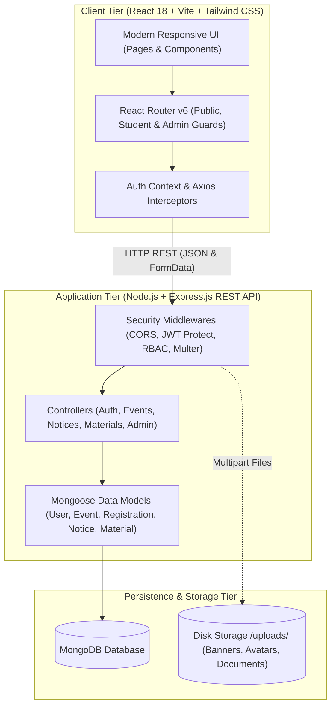

# CampusConnect – Student Campus Management System

> An enterprise-grade, full-stack campus management portal bridging college students and administrative authorities. Features 1-click event registrations with concurrency controls, broadcast notice boards, faculty study repositories, and administrative analytics dashboards.

---

## 🚀 Technology Stack

### Frontend
* **React 18** with **Vite** – Ultra-fast modern build tooling and component rendering.
* **Tailwind CSS** – Custom responsive SaaS design system with Indigo/Slate aesthetic.
* **React Router v6** – Declarative client-side routing with role-based Route Guards.
* **Axios** – HTTP client with automatic Bearer token injection and 401 session recovery interceptors.
* **Lucide React** – Clean, modern icon suite.

### Backend
* **Node.js** & **Express.js** – Modular 3-tier RESTful API architecture.
* **MongoDB** with **Mongoose ODM** – Document database with schema validations, virtual fields, and compound indexes.
* **JWT (JSON Web Tokens)** – Stateless, signed session tokens (7-day duration).
* **bcryptjs** – Industry-standard salted password hashing (10 rounds).
* **Multer** – Destination-aware file upload pipeline with MIME filtering and size caps.

---

## 🏛️ System Architecture



---

## 🌟 Key Features

### For Students
* **Authentication**: Self-service student registration with Student ID, Department, Semester, Phone, and bcrypt password hashing.
* **Student Dashboard**: Personalized greeting with quick status badges, enrolled event schedule, top urgent circulars, and quick metrics.
* **Event Discovery**: Filter by 7 categories (`Technical`, `Cultural`, `Sports`, `Workshop`, `Seminar`, `Academic`, `Other`), real-time search, capacity trackers with spots left, 1-click registration, and cancellation with confirmation dialogs.
* **Campus Notice Board**: Official circulars tagged by priority (`Urgent`, `High`, `Medium`, `Low`) and topic (`Exam`, `Placement`, `Academic`, `Event`, `General`). Pinned alerts pinned to dashboard headers.
* **Academic Repository**: Multi-tiered filter by Department and Semester (1 to 8), subject search, and direct file downloads.
* **Student Profile**: Update avatar, phone number, department, semester, and change password.

### For Administrators
* **Analytics Console**: Real-time KPI cards (*Total Students*, *Campus Events*, *Total Registrations*, *Active Announcements*, *Study Materials*).
* **Category Breakdown Chart**: Visual proportional bar chart displaying distribution across event tracks.
* **Recent Registrations Feed**: Live tabular feed of the most recent student event bookings.
* **Event Manager**: Full CRUD, image banner upload, venue, date, capacity constraints, and status controls.
* **Attendee Rosters**: Real-time student attendance roster for any event, with 1-click printing.
* **Notice Board Manager**: Broadcast notices, toggle pinned banners, assign priority indicators.
* **Material Uploader**: Upload lecture slides, lab manuals, and syllabus files (PDF, DOCX, PPTX up to 25MB).
* **Student Directory**: Complete student roster with search, department filtering, and account controls.

---

## 🔑 Demo Test Credentials

To facilitate rapid testing, the system includes quick-fill demo buttons on the login screen, or you can use these seeded credentials:

| Role | Email Address | Password | Description |
| :--- | :--- | :--- | :--- |
| **Administrator** | `admin@campusconnect.edu` | `AdminPassword123!` | Full administrative access to dashboards, events, notices, and students. |
| **Student 1** | `alex.johnson@campusconnect.edu` | `StudentPassword123!` | Computer Science, Semester 6 (Enrolled in Hackathon & Workshop). |
| **Student 2** | `sarah.williams@campusconnect.edu` | `StudentPassword123!` | Information Technology, Semester 4 (Enrolled in Cultural Fest). |
| **Student 3** | `michael.chen@campusconnect.edu` | `StudentPassword123!` | Electronics & Communication, Semester 2 (Enrolled in Football). |

---

## 📋 REST API Reference

### Authentication (`/api/auth`)
* `POST /api/auth/register` – Register new student account.
* `POST /api/auth/login` – Authenticate user (Student or Admin), return JWT token.
* `GET /api/auth/me` – Fetch authenticated user profile.
* `PUT /api/auth/profile` – Update profile details & avatar.
* `PUT /api/auth/change-password` – Change account password.

### Events & Registrations (`/api/events`)
* `GET /api/events` – List events with search, category, and registration flags.
* `GET /api/events/:id` – Get single event details.
* `POST /api/events` – Create event with banner poster upload (*Admin Only*).
* `PUT /api/events/:id` – Update event details (*Admin Only*).
* `DELETE /api/events/:id` – Delete event & cascade registrations (*Admin Only*).
* `POST /api/events/:id/register` – Register student for event (*Student Only*).
* `POST /api/events/:id/cancel` – Cancel student registration (*Student Only*).
* `GET /api/events/my-registrations` – List all events registered by student (*Student Only*).
* `GET /api/events/:id/attendees` – List student attendance roster for event (*Admin Only*).

### Announcements (`/api/announcements`)
* `GET /api/announcements` – List circulars with search and priority filters.
* `GET /api/announcements/:id` – Read single announcement.
* `POST /api/announcements` – Post new announcement (*Admin Only*).
* `PUT /api/announcements/:id` – Update announcement (*Admin Only*).
* `DELETE /api/announcements/:id` – Delete announcement (*Admin Only*).

### Study Materials (`/api/materials`)
* `GET /api/materials` – List materials filtered by department, semester, subject.
* `POST /api/materials` – Upload new study document (*Admin Only*).
* `DELETE /api/materials/:id` – Delete material and clean up storage (*Admin Only*).
* `GET /api/materials/:id/download` – Secure file download stream.

### Administration Analytics (`/api/admin`)
* `GET /api/admin/stats` – Aggregated statistics & category distribution (*Admin Only*).
* `GET /api/admin/recent-activity` – Recent student registrations feed (*Admin Only*).
* `GET /api/admin/students` – Enrolled student directory (*Admin Only*).
* `DELETE /api/admin/students/:id` – Remove student account (*Admin Only*).

---

## 💻 Local Setup & Execution Guide

### Prerequisites
* **Node.js** (v18.x or higher)
* **MongoDB** (Local instance or MongoDB Atlas connection string)
* **npm** or **yarn**

### 1. Clone & Setup Backend
```bash
cd backend

# Install dependencies
npm install

# Verify environment configuration (.env)
# PORT=5000
# MONGO_URI=mongodb://localhost:27017/campus_connect
# JWT_SECRET=super_secret_campus_connect_jwt_key_2025_secure_string_987654321
# CLIENT_URL=http://localhost:5173

# Populate sample database with Admin, Students, Events & Materials
npm run seed

# Start backend server in development mode
npm run dev
# Server listening on http://localhost:5000 (Health Check: http://localhost:5000/api/health)
```

### 2. Setup Frontend
```bash
cd ../frontend

# Install dependencies
npm install

# Start Vite development server
npm run dev
# Client live on http://localhost:5173
```

---

## 🌐 Production Deployment Guide

### Option A: MongoDB Atlas (Database)
1. Create a free cluster on [MongoDB Atlas](https://www.mongodb.com/atlas).
2. Create a database user and whitelist network access (`0.0.0.0/0`).
3. Copy the connection string: `mongodb+srv://<user>:<password>@cluster0.mongodb.net/campus_connect?retryWrites=true&w=majority`.
4. Set this as `MONGO_URI` in your backend environment variables.

### Option B: Backend Deployment (Render / Railway / DigitalOcean)
1. Connect your GitHub repository to [Render](https://render.com) or [Railway](https://railway.app).
2. Set **Root Directory** to `backend`.
3. Set **Build Command** to `npm install`.
4. Set **Start Command** to `node server.js`.
5. Add Environment Variables:
   * `PORT`: `5000`
   * `NODE_ENV`: `production`
   * `MONGO_URI`: `<Atlas Connection String>`
   * `JWT_SECRET`: `<Secure Random String>`
   * `CLIENT_URL`: `https://your-frontend-domain.vercel.app`

### Option C: Frontend Deployment (Vercel / Netlify)
1. Connect your repository to [Vercel](https://vercel.com) or [Netlify](https://netlify.com).
2. Set **Root Directory** to `frontend`.
3. Set **Build Command** to `npm run build`.
4. Set **Output Directory** to `dist`.
5. Add Environment Variable:
   * `VITE_API_URL`: `https://your-backend-domain.onrender.com/api`

---

## 🔒 Security Implementations

* **Bcrypt Password Salting**: 10 rounds of cryptographic salting before storage.
* **Password Exclusion**: Schema-level `select: false` prevents hashes from leaking in query results.
* **Stateless JWT Authorization**: Bearer tokens verified on all protected routes.
* **Role-Based Access Control (RBAC)**: Middleware strictly verifies `req.user.role === 'admin'`.
* **Database Unique Compound Index**: `{ event: 1, student: 1 }` guarantees zero duplicate registrations at database engine level.
* **Atomic Capacity Decrement/Increment**: Concurrency race conditions eliminated via atomic MongoDB updates.
* **Multer MIME & Size Filtering**: Strict validation against malicious file types with 5MB/25MB caps.

---

## 📄 License
This project is licensed under the ISC License.
